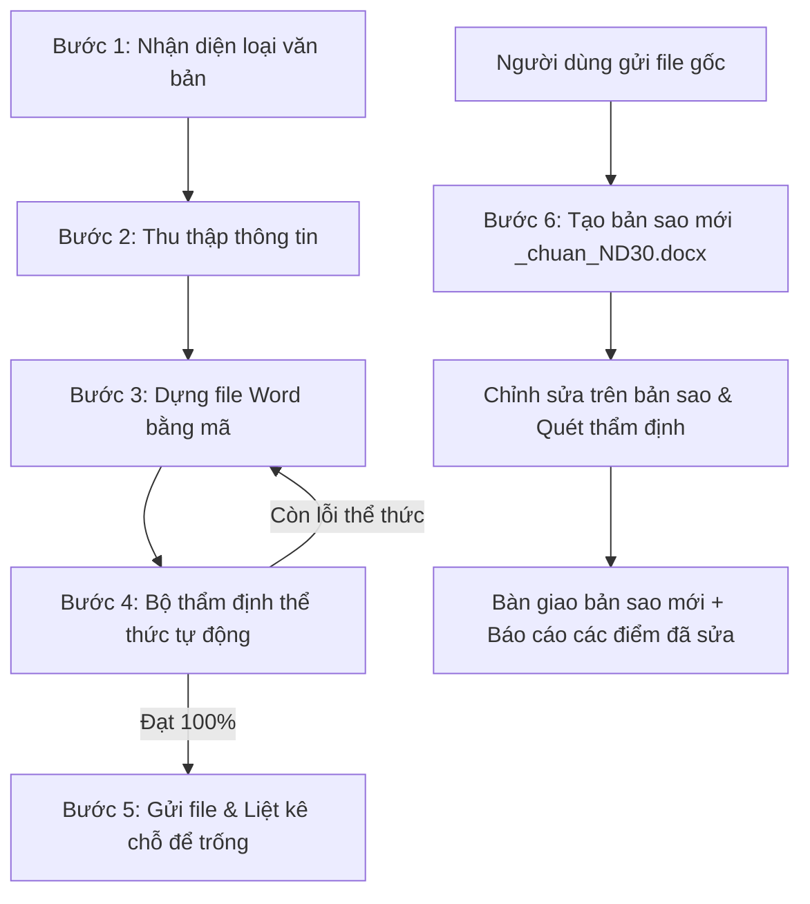

# 📜 Soạn thảo và Thẩm định Văn bản Hành chính theo Nghị định 30/2020/NĐ-CP

## 🎯 Mục đích & Triết lý vận hành

Skill này cung cấp **quy trình khép kín, chuẩn hóa và an toàn tuyệt đối** để soạn mới, dựng khuôn, chỉnh sửa và kiểm định thể thức văn bản hành chính Việt Nam theo **Nghị định 30/2020/NĐ-CP**.

### 6 Nguyên tắc cốt lõi:

1. **Bảo toàn file gốc tuyệt đối (Tiên quyết):** Khi người dùng gửi file để kiểm tra hoặc chỉnh sửa, **TUYỆT ĐỐI KHÔNG ĐƯỢC GHI ĐÈ HOẶC SỬA TRỰC TIẾP LÊN FILE GỐC**. Mọi thao tác chỉnh sửa phải được lưu vào một **bản sao mới** có hậu tố chuẩn hóa:
   `[tên_file_gốc]_chuan_ND30.docx` (Ví dụ: `Bao_cao_01.docx` $\rightarrow$ `Bao_cao_01_chuan_ND30.docx`).
2. **Thể thức do mã, không do model:** Cỡ chữ, lề trang, bảng 2 cột không viền cho Quốc hiệu/Cơ quan và Nơi nhận/Chữ ký, đường kẻ tiêu ngữ... được tạo lập chính xác bằng mã Python (`builder_docx.py`), không để AI ước lượng cảm tính.
3. **Không giao file chưa đạt (Chốt chặn chất lượng):** Sau khi tạo hoặc chỉnh sửa file `.docx`, AI bắt buộc phải chạy bộ kiểm định thể thức tự động (`validate_docx.py`). Nếu còn lỗi thể thức, AI phải tự sửa trên bản sao và kiểm tra lại. **Tuyệt đối không giao file khi còn lỗi.**
4. **Không tự bịa (Zero Hallucination):** Số hiệu văn bản, ngày tháng năm, tên người ký nếu người dùng chưa cung cấp thì dứt khoát để trống theo định dạng placeholder chuẩn `[...]` (ví dụ: `Số: [...]/QĐ-...`, `ngày [...] tháng [...] năm 20[...]`, người ký `[...]`).
5. **Hỏi gom một lần (Batch Clarification):** Trước khi tạo văn bản, quét các trường thông tin cần thiết và hỏi người dùng một lần tập trung, không hỏi rải rác làm mất thời gian.
6. **Chuẩn hóa dấu gạch nối (Khắc phục lỗi đặc trưng của AI):** Mô hình AI thường có xu hướng dùng dấu gạch ngang dài `—` (Em-dash) hoặc `–` (En-dash). Theo Nghị định 30, **tuyệt đối chỉ dùng dấu gạch nối ngắn `-` (phím `-`, ASCII 45)**:
   - **Tiêu ngữ:** Bắt buộc `Độc lập - Tự do - Hạnh phúc` (có dấu cách 2 bên). Tuyệt đối không dùng `—` hoặc `–`.
   - **Số ký hiệu:** Bắt buộc `Số: .../QĐ-UBND` (viết liền không dấu cách).
   - **Gạch đầu dòng liệt kê:** Bắt buộc dùng `- ` (dấu gạch nối ngắn kèm 1 khoảng trắng).
     Bộ code tự động phát hiện, báo lỗi FAIL trong máy kiểm tra và tự động làm sạch về `-` khi chuẩn hóa.

---

## 📂 Cấu trúc bộ Skill (10 Tài liệu Toàn diện & 4 Module Tự động hóa)

| Thành phần                 | Vai trò & Phạm vi quy chuẩn theo Nghị định 30/2020/NĐ-CP                             |
| -------------------------- | ----------------------------------------------------------------------------------- |
| `SKILL.md`                 | Hướng dẫn vận hành và quy trình 6 bước khép kín                                     |
| `01-thong-so-ky-thuat.md`  | Thông số kỹ thuật: lề trang, khổ A4, font, dải cỡ chữ, chuẩn kỹ thuật chữ ký số (Phụ lục I) |
| `02-bang-mau-chu.md`       | Quy chuẩn mẫu chữ 14 thành phần thể thức theo Mục V, Phụ lục I                      |
| `03-so-do-bo-cuc.md`       | Sơ đồ 14 ô vị trí thể thức văn bản & Sơ đồ 7 ô khối bản sao giấy (Mục IV, Phụ lục I)|
| `04-quy-tac-viet-hoa.md`   | Quy tắc viết hoa tên cơ quan, chức vụ, địa danh, ngày lễ, viện dẫn điều khoản (Phụ lục II)|
| `05-mau-van-ban.md`        | Bảng viết tắt 29 loại VB & Hệ thống mẫu chuẩn (Mẫu 1.1-1.10; 2.1-2.2; 3.1-3.2 - Phụ lục III)|
| `06-ban-sao.md`            | Thể thức bản sao giấy & bản sao điện tử (Sao y, Sao lục, Trích sao - Phụ lục I, III)|
| `07-checklist.md`          | Bảng kiểm tra 40+ tiêu chí rà soát trước khi ký ban hành                            |
| `08-quan-ly-van-ban.md`    | Quản lý văn bản đi/đến, mẫu Sổ văn bản, Bì thư, Dấu "ĐẾN" 35x50mm, Phiếu giải quyết (Phụ lục IV)|
| `09-lap-ho-so-luu-tru.md`  | Nghiệp vụ lập hồ sơ, Danh mục hồ sơ, Mục lục hồ sơ nộp lưu, Biên bản giao nhận (Phụ lục V)|
| `10-tai-lieu-dien-tu-metadata.md`| Hệ thống quản lý tài liệu điện tử & 3 Bảng chuẩn Metadata đặc tả (Phụ lục VI) |
| `scripts/constants.py`     | **Hệ thống hằng số & quy chuẩn**: Tập trung toàn bộ thông số lề, font, dải cỡ chữ, regex dùng chung |
| `scripts/builder_docx.py`  | **Bộ dựng văn bản bằng mã**: Tạo file Word với bảng 2 ô ẩn viền, đường line, lề A4 chuẩn 100% |
| `scripts/validate_docx.py` | **Bộ thẩm định thể thức**: Quét cấu trúc docx/XML phát hiện lỗi thể thức tự động   |
| `scripts/pdf_to_docx.py`   | **Bộ số hóa văn bản từ PDF**: Bóc tách nội dung từ PDF và tái sinh thành file Word chuẩn 100% |

---

## 🔄 Quy trình làm việc 6 bước chuẩn hóa



### Bước 1: Nhận diện loại văn bản

- Xác định mục đích: Quyết định, Công văn, Tờ trình, Thông báo, Biên bản, Kế hoạch...
- Tra cứu mẫu tương ứng trong `05-mau-van-ban.md`.

### Bước 2: Thu thập thông tin

- Kiểm tra các thông tin đầu vào: Cơ quan ban hành, cấp chủ quản, trích yếu nội dung, căn cứ pháp lý, người ký, nơi nhận.
- Nếu thiếu dữ liệu quan trọng, hỏi người dùng **1 lần duy nhất**.
- Với thông tin mang tính hành chính (số hiệu, ngày ban hành cụ thể): Giữ nguyên định dạng placeholder để người dùng điền sau.

### Bước 3: Dựng file Word theo thể thức

- Sử dụng công cụ `scripts/builder_docx.py` hoặc tạo script python-docx tuân thủ:
  - Khổ A4 (210×297 mm), lề Trên 20-25mm, Dưới 20-25mm, Trái 30-35mm, Phải 15-20mm (Mặc định: Trên 20, Dưới 20, Trái 30, Phải 20mm).
  - Header: Bảng 2 cột ẩn viền (Trái: Cơ quan + Số; Phải: Quốc hiệu + Tiêu ngữ + Ngày tháng).
  - Nội dung: Times New Roman, cỡ 13-14pt, căn đều hai bên (Justify), thụt đầu dòng 1-1.27cm, giãn đoạn tối thiểu 6pt, giãn dòng 1.15.
  - Footer: Bảng 2 cột ẩn viền (Trái: Nơi nhận 11pt; Phải: Chức vụ, chữ ký, họ tên người ký 13-14pt).
  - Dấu kết thúc văn bản: Kết thúc bằng dấu `./` hoặc `/.`.
  - Đánh số trang: Chính giữa lề trên (Header center), font TNR 13-14pt, không hiện ở trang đầu.

### Bước 4: Tự thẩm định thể thức (Self-Verification Loop)

- AI chạy trực tiếp lệnh kiểm định:
  ```powershell
  python .agent/skills/ND30_Skills/scripts/validate_docx.py "duong_dan_file.docx"
  ```
- Nếu có mục **FAIL** (Lỗi): AI đọc báo cáo, chỉnh sửa code và kiểm tra lại cho đến khi không còn lỗi.

### Bước 5: Bàn giao file và báo chỗ để trống

- Khi bàn giao file `.docx` đạt chuẩn, AI gửi kèm thông báo danh sách các trường người dùng cần điền hoàn thiện trước khi trình ký:
  ```markdown
  🎉 Văn bản đã đạt 100% chuẩn thể thức Nghị định 30/2020/NĐ-CP.
  ⚠️ Các vị trí để trống bạn cần điền hoàn tất:

  1. Số hiệu văn bản: tại dòng [Số: [...]/...]
  2. Ngày, tháng ban hành: tại góc phải [ngày [...] tháng [...] năm 20[...]]
  3. Họ và tên người ký: tại phần chữ ký lãnh đạo [...]
  ```

### Bước 6: Xử lý file có sẵn (Nguyên tắc BẢN SAO ĐỘC LẬP)

Khi người dùng gửi file Word (`.docx`) hoặc file PDF (`.pdf`) để kiểm tra hoặc nhờ định dạng lại:

1. **Giữ nguyên file gốc:** Tuyệt đối không lưu đè hoặc thay đổi file gốc.
2. **Xử lý theo định dạng:**
   - **Nếu là file Word (`.docx`):** Khởi tạo bản sao `[tên_gốc]_chuan_ND30.docx`, chuẩn hóa font, lề, bảng, rồi chạy `validate_docx.py`.
   - **Nếu là file PDF (`.pdf`):** Chạy công cụ `pdf_to_docx.py` (hoặc bóc tách nội dung qua AI Vision nếu là bản scan mờ) để bóc tách cấu trúc hành chính và dùng `builder_docx.py` tái sinh thành file Word mới `[tên_gốc]_chuan_ND30.docx`. Tuyệt đối không dùng công cụ convert chắp vá gây lỗi text-box hay vỡ bảng.
3. **Tự thẩm định:** Chạy `validate_docx.py` trên file bản sao mới cho đến khi đạt 100% chuẩn quy định.
4. **Bàn giao:**
   - Gửi đường link file bản sao mới `[tên_gốc]_chuan_ND30.docx`.
   - Báo cáo rõ: File gốc của bạn được giữ nguyên vẹn; tóm tắt các điểm đã được chuẩn hóa (lề, font, bảng Quốc hiệu/Nơi nhận, dấu kết thúc...); và các vị trí cần điền bổ sung.

- **Lưu ý định dạng cũ:** Nếu người dùng gửi file `.doc` (Word 97-2003), hướng dẫn người dùng mở file trong Word và chọn **Save As $\rightarrow$ .docx** trước khi hệ thống xử lý.
